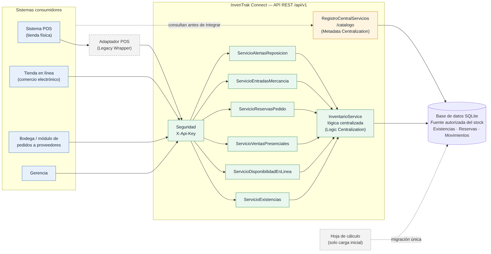
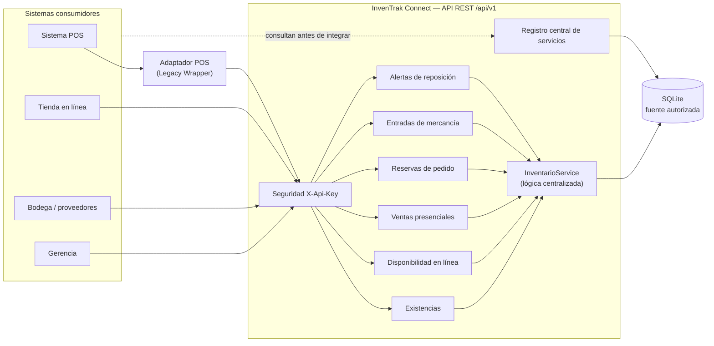
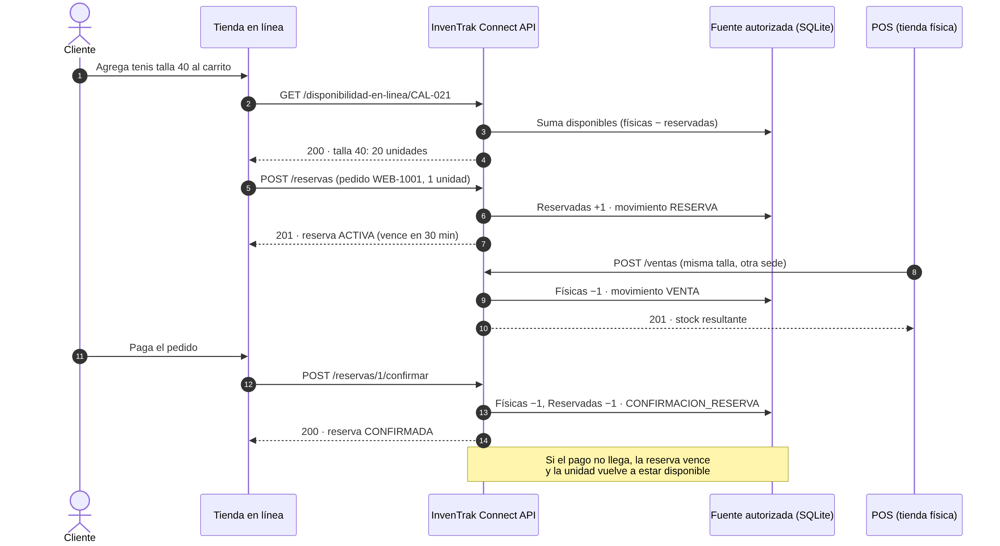

# InvenTrak Connect – Servicios de inventario para la tienda Tennis

Servicio REST que convierte el inventario de la tienda **Tennis** en un conjunto de servicios con una **única fuente autorizada del stock** y un **registro central de servicios**. El punto de partida es una arquitectura en la que cada sistema guardaba su propia copia del inventario y la sincronización era manual.

> Proyecto académico del módulo **Arquitectura del Software**, Politécnico Grancolombiano (2026).
> *Análisis y propuesta de mejora de una arquitectura orientada a servicios (SOA).*

---

## Integrantes

| Integrante | Rol |
|---|---|
| Natalie Feria Díaz | Líder de proyecto y analista de requerimientos |
| Andrés Fabián Uribe Romero | Arquitecto de software |
| Gustavo Alejandro Chacón Mendoza | Desarrollador e integrador de sistemas |
| Pablo Andrés Castellanos | Desarrollador e integrador de sistemas |
| Steeven Colorado García | Desarrollador e integrador de sistemas |

**Docente:** Jesús Antonio Figueroa Guerrero

---

## Problema que resuelve

Tennis vende ropa, calzado y accesorios en tiendas físicas y en línea. Para operar usa varios sistemas que no se comunican entre sí:

- un **POS** en la tienda física,
- una **plataforma de comercio electrónico**,
- una **hoja de cálculo compartida** que funciona como "sistema" de inventario,
- un **módulo de pedidos a proveedores** que trabaja por correo electrónico,
- y **InvenTrak**, una plataforma de inventario recién adquirida.

Ninguno está declarado como fuente autorizada del stock y la información pasa de uno a otro de forma manual. Las consecuencias son:

- se venden en línea productos que ya no existen físicamente (cancelaciones y reclamos);
- productos con existencia real no aparecen en la tienda en línea (ventas perdidas);
- el encargado de bodega actualiza a mano la hoja de cálculo, y ese paso es un **punto único de fallo**;
- no hay un catálogo que diga qué integraciones existen, quién las mantiene ni cómo usarlas.

## Solución propuesta

**InvenTrak Connect** expone el inventario como servicios REST con un contrato estandarizado:

| Patrón SOA (Erl, 2009) | Cómo se aplica en el código |
|---|---|
| **Metadata Centralization** *(patrón seleccionado)* | `/api/v1/catalogo`: registro central con nombre, descripción, responsable, versión, estado, operaciones, ubicación y consumidores de cada servicio. Rechaza duplicados (409) para promover la reutilización. |
| **Entity Abstraction / Logic Centralization** | Una sola entidad `Existencia` es la fuente autorizada del stock. Toda la lógica que modifica unidades vive en `InventarioService`; los canales solo conocen el contrato REST. |
| **Legacy Wrapper** | El POS y la hoja de cálculo no se modifican: el POS se integra mediante un adaptador que invoca `POST /ventas`, y la hoja de cálculo se reemplaza por una carga inicial única. |

### Arquitectura propuesta



<details>
<summary>Ver el diagrama en Mermaid (se dibuja directamente en GitHub)</summary>


</details>

### Flujo de una venta en línea



---

## Tecnologías utilizadas

| Tecnología | Uso |
|---|---|
| .NET 8 – ASP.NET Core Minimal API (C#) | Servicio REST |
| Entity Framework Core 8 + SQLite | Persistencia (la base se crea sola al iniciar) |
| Swashbuckle (Swagger / OpenAPI 3) | Documentación interactiva del contrato |
| xUnit + `WebApplicationFactory` | 19 pruebas de integración automatizadas |
| Postman / Newman | Colección de pruebas manuales y automatizadas |

## Requisitos para ejecutar el proyecto

- **.NET 8 SDK**: <https://dotnet.microsoft.com/download/dotnet/8.0>. Para verificar la instalación: `dotnet --version` debe mostrar `8.x`.
- Git (opcional, para clonar).
- Postman (opcional, para importar la colección).

No hace falta instalar ninguna base de datos: SQLite se crea automáticamente en el archivo `inventrak.db`.

## Instalación

```bash
git clone https://github.com/<usuario>/tennis-inventrak-soa.git
cd tennis-inventrak-soa
dotnet restore
```

## Ejecución

```bash
dotnet run --project src/InvenTrak.Api
```

Luego abra **<http://localhost:5080/swagger>** en el navegador.

- Las consultas (`GET`) se pueden probar de inmediato.
- Para las operaciones que modifican datos (`POST`/`PUT`), pulse **Authorize** y escriba la clave de demostración `tennis-2026`.
- Para volver a los datos iniciales, detenga el servicio y borre el archivo `src/InvenTrak.Api/inventrak.db`.

### Ejecutar las pruebas automatizadas

```bash
dotnet test
```

Cada prueba levanta la API completa con su propia base de datos temporal, así que no afectan los datos de trabajo.

### Probar con Postman

1. Importe `postman/InvenTrak-Connect.postman_collection.json`.
2. Con la API en ejecución, use **Run collection**. Son 24 solicitudes en orden, con verificaciones automáticas.

Para probar desde Visual Studio o VS Code (extensión REST Client) también está el archivo `requests.http`.

---

## Descripción del servicio REST

- **URL base:** `http://localhost:5080/api/v1`
- **Formato:** JSON (UTF-8)
- **Seguridad:** `POST` y `PUT` requieren la cabecera `X-Api-Key`. Cada sistema consumidor tendría su propia clave; la de demostración está en `appsettings.json`.
- **Errores:** todas las respuestas de error tienen la forma `{ "codigo": "...", "mensaje": "..." }`.

| Código HTTP | Cuándo |
|---|---|
| 200 / 201 | Operación exitosa / recurso creado |
| 400 `VALIDACION`, `SOLICITUD_INVALIDA` | Faltan campos, cantidad fuera de rango o JSON mal formado |
| 401 `NO_AUTORIZADO` | Falta la clave de API o no es válida |
| 404 `NO_ENCONTRADO` | La referencia, talla, sede, reserva o servicio no existe |
| 409 `STOCK_INSUFICIENTE`, `RESERVA_NO_ACTIVA`, `SERVICIO_DUPLICADO`, `CONFLICTO_CONCURRENCIA` | Regla de negocio incumplida |

### Endpoints disponibles

| Servicio | Método | Endpoint | Descripción | Clave |
|---|---|---|---|---|
| Salud | GET | `/health` | Verifica que el servicio está en línea | – |
| Existencias | GET | `/api/v1/productos?categoria=&busqueda=` | Lista o busca productos | – |
| Existencias | GET | `/api/v1/existencias?referencia=&talla=&sede=` | Stock físico, reservado y disponible | – |
| Disponibilidad en línea | GET | `/api/v1/disponibilidad-en-linea/{referencia}` | Unidades vendibles por talla, desde la misma fuente que el POS | – |
| Ventas presenciales | POST | `/api/v1/ventas` | Registra una venta y descuenta las unidades | ✔ |
| Reservas de pedido | POST | `/api/v1/reservas` | Aparta unidades para un pedido en línea | ✔ |
| Reservas de pedido | GET | `/api/v1/reservas/{id}` | Estado de una reserva | – |
| Reservas de pedido | POST | `/api/v1/reservas/{id}/confirmar` | Concreta la venta en línea | ✔ |
| Reservas de pedido | POST | `/api/v1/reservas/{id}/liberar` | Cancela la reserva y devuelve las unidades | ✔ |
| Entradas de mercancía | POST | `/api/v1/entradas` | Registra mercancía recibida de proveedores | ✔ |
| Alertas de reposición | GET | `/api/v1/alertas?sede=` | Referencias en o por debajo del stock mínimo | – |
| Auditoría | GET | `/api/v1/movimientos?referencia=&tipo=&limite=` | Historial de movimientos | – |
| Registro de servicios | GET | `/api/v1/catalogo?estado=&consumidor=` | Servicios publicados y sus metadatos | – |
| Registro de servicios | GET | `/api/v1/catalogo/{nombre}` | Contrato de un servicio | – |
| Registro de servicios | POST | `/api/v1/catalogo` | Publica un servicio nuevo | ✔ |
| Registro de servicios | PUT | `/api/v1/catalogo/{nombre}` | Actualiza versión, estado o contrato | ✔ |

### Reglas de negocio implementadas

- `disponibles = unidadesFisicas − unidadesReservadas`. Ninguna venta ni reserva puede dejar el stock en negativo.
- Una reserva vence a los `minutosVigencia` (30 por defecto) si no se confirma, y sus unidades vuelven a estar disponibles automáticamente.
- Una reserva confirmada, liberada o vencida ya no se puede modificar.
- Si una talla no existía en una sede, una entrada de mercancía crea su registro.
- Hay alerta de reposición cuando `disponibles ≤ stockMinimo`. La cantidad sugerida es `2 × stockMinimo − disponibles`.
- Cada operación queda registrada en la auditoría (`/movimientos`).
- La concurrencia es optimista: si dos canales modifican la misma existencia al mismo tiempo, uno recibe `409 CONFLICTO_CONCURRENCIA` en lugar de perder la actualización.

### Datos de ejemplo

Al iniciar se cargan 7 productos (sweaters, jeans, chaquetas, tenis, botas, gorras y morrales), cada uno en sus tallas y en tres sedes (`TIENDA-CENTRO`, `TIENDA-NORTE` y `BODEGA-CENTRAL`), junto con los 7 servicios del catálogo. Algunos casos están preparados a propósito para las pruebas: `SWT-001` talla `L` en `TIENDA-NORTE` tiene 0 unidades y `CAL-021` talla `40` en `TIENDA-NORTE` tiene 1.

---

## Ejemplos de uso

### 1. Consultar existencias

```http
GET /api/v1/existencias?referencia=CAL-021&talla=40
```

```json
[
  {
    "referencia": "CAL-021",
    "producto": "Tenis urbanos blancos",
    "talla": "40",
    "sede": "TIENDA-NORTE",
    "unidadesFisicas": 1,
    "unidadesReservadas": 0,
    "disponibles": 1,
    "stockMinimo": 3,
    "ultimaActualizacion": "2026-10-12T20:56:20Z"
  }
]
```

### 2. Registrar una venta en el POS

```http
POST /api/v1/ventas
X-Api-Key: tennis-2026
Content-Type: application/json

{ "referencia": "CAL-021", "talla": "40", "sede": "TIENDA-NORTE", "cantidad": 1, "canal": "POS" }
```

Respuesta **201 Created**:

```json
{
  "movimientoId": 1,
  "tipo": "VENTA",
  "referencia": "CAL-021",
  "talla": "40",
  "sede": "TIENDA-NORTE",
  "cantidad": 1,
  "canal": "POS",
  "documento": null,
  "stockResultante": { "unidadesFisicas": 0, "unidadesReservadas": 0, "disponibles": 0, "stockMinimo": 3 }
}
```

Si se repite la misma venta, la respuesta es **409 Conflict**:

```json
{ "codigo": "STOCK_INSUFICIENTE", "mensaje": "Solo hay 0 unidad(es) disponibles de CAL-021 talla 40 en TIENDA-NORTE." }
```

### 3. Reservar y confirmar un pedido en línea

```http
POST /api/v1/reservas
X-Api-Key: tennis-2026
Content-Type: application/json

{ "pedido": "WEB-1001", "referencia": "JEA-014", "talla": "M", "sede": "BODEGA-CENTRAL", "cantidad": 2, "minutosVigencia": 30 }
```

```http
POST /api/v1/reservas/1/confirmar
X-Api-Key: tennis-2026
```

### 4. Consultar el registro central de servicios

```http
GET /api/v1/catalogo/ServicioExistencias
```

```json
{
  "nombre": "ServicioExistencias",
  "descripcion": "Consulta del stock por referencia, talla y sede. Fuente autorizada del inventario.",
  "responsable": "InvenTrak",
  "version": "1.0.0",
  "estado": "PUBLICADO",
  "operaciones": ["GET /api/v1/existencias", "GET /api/v1/productos"],
  "ubicacion": "/api/v1/existencias",
  "consumidores": ["POS", "Tienda en línea", "Bodega", "Gerencia"]
}
```

---

## Evidencias de funcionamiento

Las capturas de la carpeta [`docs/evidencias`](docs/evidencias) muestran solicitudes reales ejecutadas desde Swagger UI contra el servicio en funcionamiento:

| # | Evidencia | Resultado |
|---|---|---|
| 01 | [Vista general del contrato en Swagger](docs/evidencias/01-swagger-vista-general.png) | 16 operaciones documentadas |
| 02 | [Venta sin clave de API](docs/evidencias/02-venta-sin-clave-401.png) | 401 |
| 03 | [Catálogo filtrado por consumidor POS](docs/evidencias/03-catalogo-servicios-200.png) | 200 |
| 04 | [Consulta de existencias](docs/evidencias/04-existencias-consulta-200.png) | 200 |
| 05 | [Venta registrada](docs/evidencias/05-venta-registrada-201.png) | 201 |
| 06 | [Venta sin stock](docs/evidencias/06-venta-sin-stock-409.png) | 409 |
| 07 | [Disponibilidad en línea](docs/evidencias/07-disponibilidad-en-linea-200.png) | 200 |
| 08 | [Reserva creada](docs/evidencias/08-reserva-creada-201.png) | 201 |
| 09 | [Reserva confirmada](docs/evidencias/09-reserva-confirmada-200.png) | 200 |
| 10 | [Entrada de mercancía](docs/evidencias/10-entrada-mercancia-201.png) | 201 |
| 11 | [Alertas de reposición](docs/evidencias/11-alertas-reposicion-200.png) | 200 |
| 12 | [Auditoría de movimientos](docs/evidencias/12-auditoria-movimientos-200.png) | 200 |
| 13 | [Pruebas automatizadas (`dotnet test`)](docs/evidencias/13-pruebas-automatizadas.png) | 19/19 superadas |
| 14 | [Ejecución de la colección Postman con Newman](docs/evidencias/14-postman-newman.txt) | 24 solicitudes, 30 verificaciones, 0 fallos |

---

## Estructura del proyecto

```
tennis-inventrak-soa/
├── src/InvenTrak.Api/
│   ├── Program.cs                 # Configuración, Swagger y registro de endpoints
│   ├── Endpoints/                 # Contrato REST (interfaz de los servicios)
│   │   ├── InventarioEndpoints.cs
│   │   └── CatalogoEndpoints.cs
│   ├── Services/                  # Implementación de los servicios (lógica de negocio)
│   │   ├── InventarioService.cs
│   │   ├── CatalogoService.cs
│   │   └── Resultado.cs
│   ├── Models/                    # Entidades y DTOs de entrada/salida
│   ├── Data/                      # DbContext de EF Core y datos de ejemplo
│   └── Seguridad/                 # Filtro de clave de API
├── tests/InvenTrak.Api.Tests/     # Pruebas de integración (xUnit)
├── postman/                       # Colección de Postman
├── docs/
│   ├── arquitectura/              # Diagramas (PNG y fuente Mermaid)
│   └── evidencias/                # Capturas y resultados de pruebas
├── requests.http                  # Solicitudes de ejemplo para el IDE
└── TennisInventrak.sln
```

La separación entre `Endpoints` (interfaz) y `Services` (implementación) corresponde a la distinción entre interfaz e implementación del servicio analizada en el documento: la lógica interna puede cambiar sin afectar a los consumidores mientras el contrato se mantenga.

## Alcance y limitaciones del prototipo

- Es un **prototipo académico**. No se conecta al POS, al comercio electrónico ni a InvenTrak reales. Simula la capa de servicios que InvenTrak expondría, y los consumidores se representan con Swagger, Postman y las pruebas.
- La seguridad usa una clave de API fija. En producción se reemplazaría por OAuth 2.0 o JWT, con una clave por sistema consumidor y HTTPS.
- SQLite es suficiente para la demostración. Un despliegue real usaría un motor de servidor como PostgreSQL, que se puede cambiar en una línea de `Program.cs`.
- La mensajería por eventos (Event-Driven Messaging) queda como evolución futura.

## Referencias

- Erl, T. (2009). *SOA design patterns*. Prentice Hall.
- Erl, T. (2005). *Service-oriented architecture: Concepts, technology, and design*. Prentice Hall.
- Hohpe, G., & Woolf, B. (2003). *Enterprise integration patterns*. Addison-Wesley.
- Microsoft. (2024). *Minimal APIs overview*. <https://learn.microsoft.com/aspnet/core/fundamentals/minimal-apis>
